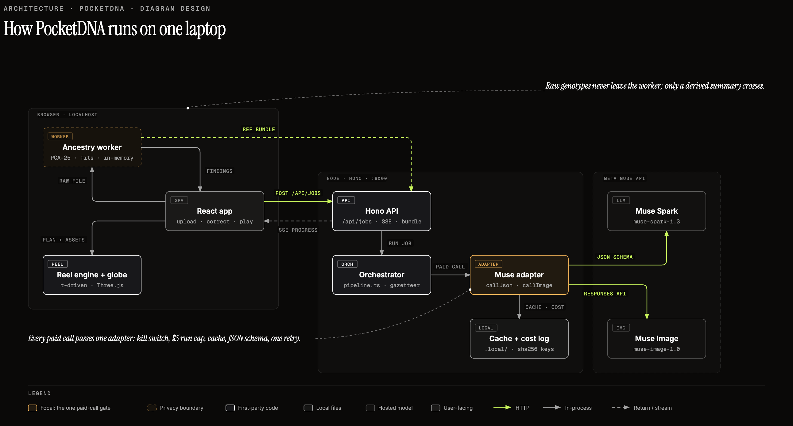
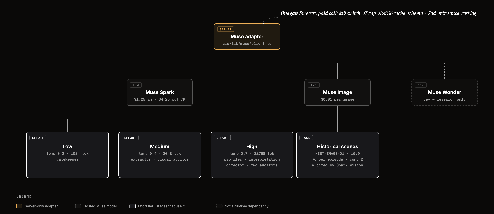

# PocketDNA

**Finding Your Roots for everyone.** Drop an ancestry result and get a cited, two-minute
documentary about where your story fits in human history, written, directed, illustrated and
audited end to end by Meta's Muse models.

Meta Global AI Developer Hackathon, Oct 26 - Nov 4, 2026. Solo, Indie Developer track.
Everything in this repository was built during the event window. 

---

## Judges: run it in 2 minutes

You need Node 20 or newer and a browser. No Python, no GPU, no database, no hosted account.

```sh
git clone <this repo> pocketdna && cd pocketdna
npm install
npm run serve        # builds, then serves app + API at http://localhost:8000
```

Open **http://localhost:8000**. That is the whole setup.

### What you can do, by how much you want to set up

| You have | Do this | What you see |
| --- | --- | --- |
| Nothing else | Click the small **Replay mode: saved episode, no upload or key needed.** link under the upload card | The saved 120-second film with its globe, reviewed historical scenes and a source drawer. Tap any claim to pause and open its citation. **No key, no network call, no cost.** |
| A Meta Model API key | Copy the key into `.env` (below), restart, then upload `tests/fixtures/composition.png` (a 23andMe ancestry screenshot fixture) | A live run. The processing screen shows each Muse agent working: gatekeeper, extractor, you correct the numbers, then profiler, interpretation, director, both audits, and Muse Image scenes. WARNING: TAKES 8-12 minutes to process so you might just see the demo video in [demo/](demo/pocketdna-live-episode.mp4) |
| Nothing, just want to see the live output | Open `demo/pocketdna-live-episode.mp4` and its `.manifest.json` | A 120-second export of one real live run on my own raw 23andMe file, plus the exact citations and one row per Muse call (model, effort, tokens, USD, duration). See [demo/EXPORT.md](demo/EXPORT.md). |

```sh
# .env  (git-ignored; never commit a real key)
META_API_KEY=your-key-from-dev.meta.ai
```

Optional variables: `KILL_PAID_CALLS=1` refuses every paid call (the app degrades to typed
errors and the replay, never a hang), `PORT` changes the port (default 8000),
`POCKETDNA_LOCAL_DIR` moves the cache and cost log (default `.local/`).

### Honest limits of the judge path

- The production of a 3 minute short takes roughly 8-12 minutes. Within this time, the DNA raw file is projected against reference samples first, ancestry calculations are computed and fed to Muse. Muse then processes these calculations, validating them by performing web searches and cross referencing them with scientific publications, directing the script of the episode, setting the pace, crafting the content. Muse Image generates images and all these take time. 

- **Raw DNA files (`.txt` / `.zip` from 23andMe or AncestryDNA) need a reference bundle that
  is not in git.** The PCA-25 reference arrays, era panels and gazetteer are built from
  licensed AADR / SGDP / EGDP downloads and live in the git-ignored `dataset/` tree
  ([dataset/README.md](dataset/README.md) explains the provenance and rebuild path). On a fresh
  clone the browser raw-analysis route will report the bundle as missing. The saved live
  episode in `demo/` shows what that path produces, and the code, the deterministic engine
  and its tests are all in the repo.

- This build calls the hosted Meta Model API. It does not run Muse Glimmer / Spark Open.


## What it does, in one picture

People post the same DNA pie chart on Reddit and Facebook groups asking strangers "what does
this mean?" A professional genealogist costs about $2,000 for the answer. PocketDNA gives
everyone their own episode:

1. **Drop your result.** A 23andMe or AncestryDNA raw data file (usually a .txt or .zip file)
2. **The math is deterministic.** For raw files, ancestry is population genetics running in a
   Web Worker in your browser: parse, quality-check, project onto a fixed reference basis,
   fit each era separately. The DNA data file never leave the device. **Muse NEVER computes
   ancestry.**
3. **Muse does what only a model can.** Read the results of genetics pipeline, research and cite,      write the story, direct a timed film, paint the scenes, and audit all of it.
4. **A film plays.** Hook, method beat, Bronze Age, Middle Ages, Modern, convergence, source
   stamp. Every claim is a button that opens its source.

Ancestry only. No health, traits or personality. No modern nations as heirs. No battle
imagery. A health panel is rejected up front with a typed message.


## How I built this

I had a much more ambitious scope: build a mobile app in React Native/Expo and make a reels style
micro documentary in 9:16 format. If you check the the [Git Commit history](https://github.com/rmonsur/pocketdna/commit/2ba3c5a6c6557d8f4276396255539f4960682e2c). this is the direction I was taking 5 days ago. Unfortunately my preeliminary test build was rejected by Testflight and the bionformatics genetic pipeline (more on that below) took longer than expected so I focused entirely on a scoped out and deliverable web app as a last dash effort.

The Bionformatics pipeline involves downloading >10GB of open source/CC license genetic data, prepping the dataset and then finally building a reference panel out of that dataset to compare our 23andMe results against. Since original, intermediary and final dataset volume easily exceeds 25 GB I have excluded them from the repo and instead shared links on where I downloaded them from. 

Muse Wonder (medium mode) was crucial in this genetic pipeline. I was able to speedrun easily a weeks worth of work in 2 days. The genetic calculations to compute ancestry were also reverse engineered by Muse Wonder. Word of caution: lots of optimization and fine tuning needs to be done to the reverse engineered genetics calculations but I hope it shows the power of these models. 


## Architecture

[](diagram/01-system-architecture.html)

*Open [diagram/01-system-architecture.html](diagram/01-system-architecture.html) for the
interactive original. Drawn from [docs/STACK.md](docs/STACK.md) and checked against the code.*

How to read it:

- **Browser zone.** The React app, the in-memory ancestry Web Worker (dashed amber: the one
  place raw genotypes ever exist) and the deterministic reel engine that plays the film.
- **One arrow leaves the browser.** It carries derived findings, never genotypes. Raw files
  are held in browser memory and released on reset. Nothing is logged or sent to analytics.
- **Local server zone.** A Hono server on one localhost origin: `/api/jobs` to start an
  episode, server-sent events on `/api/jobs/:id/events` for live progress and cancellation,
  `/api/raw-episodes` (strict Zod validation) for the browser's derived findings, and
  `/api/bundle` for the public reference arrays.
- **The orchestrator** sequences the agents and enforces the audit gates.
- **One Muse adapter.** Every model call in the product goes through a single typed module
  (`src/lib/muse/client.ts`). It owns the kill switch, a per-run cost cap, a sha256 response
  cache, JSON-schema structured output, Zod validation with one retry, and a cost log.
- **Muse zone.** Muse Spark for reading, reasoning and review. Muse Image for scenes.

Why this shape: judges and users get one command and one port, and a privacy story that is a
property of the architecture, not a promise. Python, PLINK and EIGENSOFT are offline research
tools used to build and validate the reference bundle, never a runtime requirement.
Full specification: [docs/STACK.md](docs/STACK.md).

---

## How Muse runs everything in the background

[](diagram/07-muse-model-map.html)

*Open [diagram/07-muse-model-map.html](diagram/07-muse-model-map.html) for the original.*

One adapter, three effort tiers. The tier is chosen per task so cheap steps stay cheap and
the reasoning-heavy steps get the budget (settings from `src/lib/muse/models.ts`):

| Effort | Temperature | Token cap | Used for |
| --- | --- | --- | --- |
| low | 0.2 | 1,024 | Gatekeeper: detect the vendor, reject health and unsupported panels |
| medium | 0.4 | 2,048 | Extractor (read percentages, ranges and hierarchy from a screenshot) and the visual auditor that inspects each generated image |
| high | 0.7 | 32,768 | Population profiler, interpretation with citations, director, narrative audit, compliance audit |

| Model | Role |
| --- | --- |
| **Muse Spark 1.3** | Every text and vision stage above, including all three auditors. $1.25 in / $4.25 out per million tokens. |
| **Muse Image 1.0** | Historical illustrations. Up to six scenes, two at a time, each audited by Spark and repaired at most once, with a reviewed fallback image if it still fails. |
| **Muse Wonder** | Development and research assistant only. Not in the user's runtime path. |
| **Muse Code** | Wrote the codebase during the event, including the browser ancestry engine. |

### The agent crew, in order

The pipeline lives in `src/server/pipeline.ts`. The full role roster, inputs, outputs and
authority limits are in [AGENTS.md](AGENTS.md).

1. **Gatekeeper** (Spark, low) accepts a supported ancestry panel and rejects health reports.
2. **Extractor** (Spark, medium) reads a screenshot into typed numbers. **You correct them**
   before anything else runs, so a misread digit cannot reach the film.
3. **Interpretation, then population profiler** (Spark, high) turn evidence into plain
   language with a source locator on every claim, then into readable cards for the
   closest reference populations. They cannot change a number or infer
   traits or personal routes.
4. **Director** (Spark, high) writes one complete, timed script: hook, method beat, three
   era chapters, convergence, ending. Method: [docs/DIRECTOR.md](docs/DIRECTOR.md).
5. **Narrative auditor** and **compliance auditor** (Spark, high) review the exact script.
   One checks captions, numbers, qualifiers and source links. The other enforces ancestry-only,
   privacy and imagery rules. If either fails, the director gets one repair; a second failure
   stops with a typed error. **Nothing renders until both pass.**
6. **Atlas scenes** are built deterministically from a gazetteer of cited, dated sites.
   Geography never comes from a model's memory. Spec: [docs/ATLAS.md](docs/ATLAS.md).
7. **Historical image agent** (Muse Image, audited by Spark) paints the scenes. States, tools
   and acceptance checks: [docs/AGENT.md](docs/AGENT.md); prompts and provenance:
   [docs/IMAGE.md](docs/IMAGE.md). Generated people are fictional inhabitants of a documented
   setting, never portraits of the viewer's ancestors.
8. **Reel assembler** (deterministic code) plays the approved plan. Every frame is a pure
   function of time, so the preview and the MP4 export are identical.

The separation is the point: **writers never grade their own work, and auditors never write.**

### What every Muse call goes through

Each call is: kill switch check, run-cap check, sha256 cache lookup (hit costs $0), POST with
a JSON schema, Zod validation, one retry with the validation error fed back, cache write, and
an appended cost-log row. A model response that fails validation is never rendered raw.
Prompts live in versioned files under [prompts/](prompts/), not inline strings.

Every diagram page also carries a plain-language walkthrough underneath it: for each
step it says what the step receives, what it does, what it hands to the next agent, why a
Muse model (or deliberately no model) is used there, and which guard limits it. Start with
[diagram/03-evidence-to-film.html](diagram/03-evidence-to-film.html) to see the hand-offs
between agents.

---

## Inputs and the science

| Input | Handling |
| --- | --- |
| Raw export (`.txt` / `.zip`, up to 50 MB) | Parsed, QC'd and analysed in a browser Web Worker. Projection into **PocketDNA PCA-25** with a fixed basis, then separate Bronze Age, Medieval and Modern fits with weights that sum to one. Poor coverage yields a limitation, not invented precision. |

Percentages are never added across eras, and nothing implies a proven genealogical chain.
A Python reference implementation was compared against the Reich Lab's smartpca (reported
Procrustes similarity about 0.999, an implementation check rather than a projection-parity
proof; see [docs/BIOINFORMATICS.md](docs/BIOINFORMATICS.md) for the metric definitions and
the validation gates still required). References: AADR v66 (Reich Lab), SGDP, EGDP, with
candidate populations catalogued in [docs/POPLIST.md](docs/POPLIST.md).

---

## Genomic datasets

The ancestry engine is built from public reference data. **None of these files are in the
repository because they are far too large for Git** (the largest genotype file is several
gigabytes). The repo contains the compact derived arrays the browser needs, the scripts that
rebuild them, and the documents that record provenance. Sizes below were measured on the
builder's machine.

| Dataset | Used for | Size on disk | Source |
| --- | --- | --- | --- |
| AADR v66.1, 1240K (Allen Ancient DNA Resource, Reich Lab, DOI 10.7910/DVN/FFIDCW) | Ancient source groups for the Bronze Age and Medieval fits; dated sampling sites behind citations and globe markers | about 6.6 GB genotypes, 74 MB markers, 13 MB annotations | [dataverse](https://dataverse.harvard.edu/dataset.xhtml?persistentId=doi:10.7910/DVN/FFIDCW) |
| AADR v66.1, Human Origins | Present-day reference populations and the marker set of the PCA-25 basis | about 3.8 GB plus 1.8 GB compatibility genotypes | [dataverse](https://dataverse.harvard.edu/dataset.xhtml?persistentId=doi:10.7910/DVN/FFIDCW) |
| EGDP (Estonian Biocentre Human Genome Diversity Panel, Pagani et al.) | Regional gaps in the modern reference set | about 131 MB | [archives](https://evolbio.ut.ee/CGgenomes.html) |
| SGDP (Simons Genome Diversity Project) | More modern reference individuals; cross-check | about 41 MB | [SGDP](https://reichdata.hms.harvard.edu/pub/datasets/sgdp/) |
| Builder's own 23andMe export | Test input for the demo episode; private, git-ignored | about 24 MB | [23andMe](dataset/genome_reshad_%20monsur_n_v2_v3_Full_20171127205355.txt) |

Provenance, identity checks and the rebuild path: [dataset/README.md](dataset/README.md),
[docs/BIOINFORMATICS.md](docs/BIOINFORMATICS.md) and [docs/POPLIST.md](docs/POPLIST.md).
The same table appears on the architecture and input diagrams; edit it once in
`diagram/datasets.mjs`.

---

## Documentation map

Start with [docs/ABOUT.md](docs/ABOUT.md). Specialist contracts override nothing silently.

| Document | What it covers |
| --- | --- |
| [docs/ABOUT.md](docs/ABOUT.md) | Product scope, shared decisions, scientific and privacy boundaries, delivery plan |
| [docs/RULES.md](docs/RULES.md) | Hackathon compliance, ancestry and privacy rules, engineering and budget gates |
| [docs/STACK.md](docs/STACK.md) | Runtime architecture, contracts, installation, storage, export |
| [AGENTS.md](AGENTS.md) | Build ownership and the complete runtime agent roster and handoffs |
| [docs/AGENT.md](docs/AGENT.md) | Historical image agent state machine and acceptance checks |
| [docs/IMAGE.md](docs/IMAGE.md) | Image briefs, prompts, generation and repair budget, provenance |
| [docs/DIRECTOR.md](docs/DIRECTOR.md) | Script method, timed plan, caption readability |
| [docs/ATLAS.md](docs/ATLAS.md) | Geographic research, globe rendering, map semantics |
| [docs/BIOINFORMATICS.md](docs/BIOINFORMATICS.md) | PCA-25 method, QC, projection, fitting, validation gates |
| [docs/DESIGN.md](docs/DESIGN.md) | Dark visual tokens, layout, controls, evidence interaction, error states |
| [docs/POPLIST.md](docs/POPLIST.md) | Candidate population and sample catalogue with provenance |
| [diagram/README.md](diagram/README.md) | Seven schematic diagrams plus an interactive isometric bench |

All diagrams are self-contained HTML under [diagram/](diagram/). For example,
[diagram/04-agent-swimlane.html](diagram/04-agent-swimlane.html) shows who hands what to whom
and [diagram/05-muse-call-sequence.html](diagram/05-muse-call-sequence.html) shows one model
call end to end.

---

## Hackathon compliance at a glance

- **Public repo, new work only.** Built Oct 26 - Nov 4. The README states what is reused (none).
- **Banned categories avoided by construction.** Not an image analyzer: the screenshot is one
  convenience input, and the product is the engine and the film. Not medical advice: health
  panels are rejected. Not a personality analyzer: copy that infers traits is blocked by the
  compliance auditor. Not political: migration and expansion language only.
- **Privacy.** Raw genotypes stay in browser memory and out of logs. The builder's own export
  is git-ignored since the 2026-11-05 security pass. Public demo inputs need redistribution
  permission.
- **Cost control.** Kill switch, per-run cap, cache and a cost log on every call.

---

## Repository layout

```
src/app/        Landing, reel player, library and atlas pages (React, Vite, strict TypeScript)
src/server/     Hono API, job runner, pipeline, image agent, atlas scenes, gazetteer
src/lib/muse/   The single Muse adapter and model/effort/pricing table
src/features/   Browser ancestry engine (Web Worker) and reel features
src/reel/       Deterministic time-driven film renderer
src/contracts/  Zod schemas: EvidenceRecord, ReelPlan, manifests, replay fixtures
prompts/        Versioned prompt files for every agent
public/assets/  Reviewed replay images and manifest
tests/          Offline test suite (Node test runner) and fixtures
docs/           Reconciled specifications; start with ABOUT.md
diagram/        Architecture, agent and model diagrams (HTML) and previews
demo/           Saved live episode (MP4 plus evidence manifest) and fixtures
dataset/        Git-ignored local reference-data staging; see its README
research/       Offline scientific tooling (Python, EIGENSOFT) for the reference bundle
app/, backend/  Earlier Expo/FastAPI prototype, kept for reference and not on the judge path
```

---

## Data rights

- The builder's own DNA export is kept on disk for local testing.
- Reference data: AADR v66.0 (Reich Lab, Harvard Dataverse, DOI 10.7910/DVN/FFIDCW; Mallick
  et al. 2024, Scientific Data), SGDP and EGDP, cited in [docs/POPLIST.md](docs/POPLIST.md).
- The film clock pattern is adapted from MengTo Skills html-reel (MIT, attributed).
- Diagrams use the MIT-licensed diagram-design and anatomy skills; see
  [diagram/README.md](diagram/README.md).

---

## Agent skills used to build and review this project

Installed at user scope and used during development. Review records live in
[muse-loop/qa-logs/](muse-loop/qa-logs/).

| Skill | Source | Used for |
| --- | --- | --- |
| code-review | [mattpocock/skills](https://github.com/mattpocock/skills) | Two-axis review of the working tree |
| tdd | [mattpocock/skills](https://github.com/mattpocock/skills) | Tests at public seams (model JSON, extractor rejection, server boundaries) |
| diagnosing-bugs | [mattpocock/skills](https://github.com/mattpocock/skills) | Extractor rejection bug and reel-plan tiling defect |
| security-and-hardening | [addyosmani/agent-skills](https://github.com/addyosmani/agent-skills) | Upload caps, content sniffing, localhost binding, timeouts, headers, genome gitignore fix |
| impeccable | [pbakaus/impeccable](https://github.com/pbakaus/impeccable) | Design critique and technical audit |
| diagram-design, anatomy | [cathrynlavery/diagram-design](https://github.com/cathrynlavery/diagram-design), [wheresryan22/anatomy](https://github.com/wheresryan22/anatomy) | The diagrams in `diagram/` |
